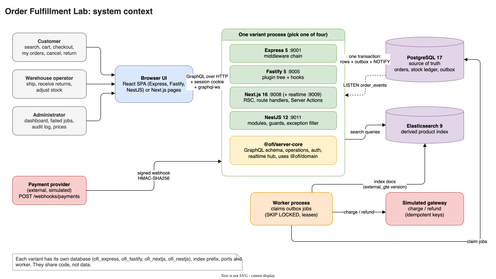
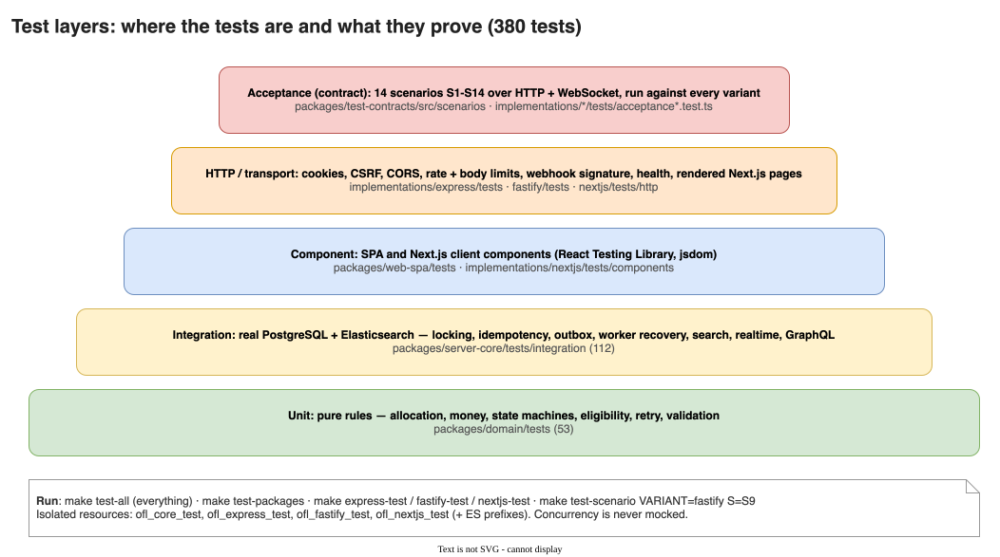

# Architecture

Diagrams, an interactive walkthrough of each project, test instructions, and
the product requirements for the Order Fulfillment Lab.

| Path | Content |
| --- | --- |
| [`interactive/index.html`](interactive/index.html) | Start here. Animated, clickable walkthroughs of every project (`make architecture` opens it) |
| [`diagrams/`](diagrams/) | 11 draw.io diagrams (`.drawio` sources, `.drawio.svg` exports with the diagram embedded) |
| [`PRD.md`](PRD.md) | Product requirements: problem, users, scope, requirements, success criteria |
| This file | What the project is, what each component does, where the tests are, how to run them |

## 1. What the project is

One order fulfillment and inventory platform, built four times:

| Project | Folder | Server | Browser UI |
| --- | --- | --- | --- |
| Express | `implementations/express` | Express 5 + GraphQL Yoga, port 9001 | Shared React SPA, port 9002 |
| Fastify | `implementations/fastify` | Fastify 5 + GraphQL Yoga, port 9005 | Shared React SPA, port 9006 |
| Next.js | `implementations/nextjs` | Next.js 16 App Router, port 9008 (+ realtime 9009) | Server Components + client components |
| NestJS | `implementations/nestjs` | NestJS 12 on Express 5 + GraphQL Yoga, port 9011 | Shared React SPA, port 9012 |

All four call the same application layer (`packages/server-core`), use the
same PostgreSQL schema and GraphQL contract, and pass the same 14 acceptance
scenarios. The differences are framework mechanics only.



## 2. Interactive walkthroughs

Open `architecture/interactive/index.html` in a browser (no server or build
needed), or run `make architecture`.

| Page | What you can watch |
| --- | --- |
| Overview (`index.html`) | Project map, a clickable test map, the 14 acceptance scenarios with links, the diagram gallery, commands |
| Express (`express.html`) | 11 scenarios through the `app.use` chain: sign in, search, checkout → payment → live update, declined payment, signed webhook (+ duplicate, + forged), slow payment vs expiry, shipping from two warehouses, return and refund, 20 buyers for 5 units, idempotent retry, price change → re-index |
| Fastify (`fastify.html`) | The same 11 scenarios through the plugin tree: which scope's hooks run, `preValidation` CSRF, scoped raw-body parser, `wsHandler` |
| Next.js (`nextjs.html`) | The same scenarios through Server Components, `unstable_cache`, Server Actions, `withGuards` route handlers and the separate realtime process |
| NestJS (`nestjs.html`) | The same 11 scenarios through Nest's stages (Express middleware → Nest middleware per controller → guards → controller → exception filter), plus two NestJS-only ones: errors reaching the filter from three stages, and the `app.close()` shutdown order |
| Shared core & worker (`core.html`) | Transactional outbox, worker crash after charging (S7), retries/backoff/FAILED + admin retry, out-of-order search events (S8), expiry sweeper, ledger reconcile, zero-downtime reindex |

Each step moves a packet between components and shows, on the right:

- the request, SQL statement or message for that hop, with an explanation;
- **What the user sees** (a small browser screen);
- **World state**: order and payment status, stock (`on_hand`, `reserved`, `available` per warehouse), outbox jobs;
- the tests that prove the behavior.

Controls: **▶ Play**, **Step ▶**, **◀ Back**, **↺ Reset**, speed, and a clickable step list.
Keyboard: Space, ←, →, R. Click any box for its role, code location and tests.
The **Try it** tab has the real commands or UI steps for your machine.
Ids and prices in the animations (`ORD-1042`, `TR-42`, $89.00) are illustrative;
the steps, SQL shapes, headers and rules follow the code.

Files: `interactive/assets/engine.js` (renderer and player),
`interactive/assets/scenarios.js` (scenarios shared by the four projects),
one HTML file per page with that project's components.

## 3. Diagrams

Open a `.drawio` file in the draw.io desktop app or at app.diagrams.net to
edit it. After editing, run `make diagrams` to refresh the `.svg` exports.

| Diagram | Shows |
| --- | --- |
| [01 System context](diagrams/01-system-context.drawio.svg) | Roles, browser, the four variants, server-core, PostgreSQL, Elasticsearch, worker, gateway, payment provider |
| [02 Monorepo packages](diagrams/02-monorepo-packages.drawio.svg) | Package dependencies and the rule "framework code holds no business rules" |
| [03 Express pipeline](diagrams/03-express-request-pipeline.drawio.svg) | Middleware order and why it matters |
| [04 Fastify plugin tree](diagrams/04-fastify-plugin-tree.drawio.svg) | Root scope, browser API scope, webhook scope, lifecycle hooks |
| [05 Next.js boundaries](diagrams/05-nextjs-boundaries.drawio.svg) | Layouts, Server Components, Server Actions, guarded route handlers, realtime process |
| [06 Checkout sequence](diagrams/06-checkout-payment-sequence.drawio.svg) | Checkout transaction, worker payment, NOTIFY to the browser |
| [07 Outbox lifecycle](diagrams/07-outbox-worker-lifecycle.drawio.svg) | PENDING → PROCESSING → DONE / FAILED, leases, backoff, retry |
| [08 State machines](diagrams/08-state-machines.drawio.svg) | Order, reservation, payment, return |
| [09 Data model](diagrams/09-data-model.drawio.svg) | Main tables and the ledger invariant |
| [10 Test layers](diagrams/10-test-layers.drawio.svg) | Unit → integration → component → HTTP → acceptance |
| [11 NestJS lifecycle](diagrams/11-nestjs-request-lifecycle.drawio.svg) | Express middleware, per-controller Nest middleware and guards, exception filter, WebSocket provider, shutdown hooks |

## 4. Components and what they do

| Component | Responsibility | Code |
| --- | --- | --- |
| Browser UI | Search, cart, checkout, orders, warehouse and admin screens; GraphQL over HTTP, live status over graphql-ws | `packages/web-spa`, `implementations/nextjs/app` |
| Framework layer | Correlation id, security headers, CORS, rate limits, session cookie, CSRF header, body limits, webhook raw body, health, shutdown | `implementations/*/api`, `implementations/nextjs/modules/server` |
| GraphQL schema | Thin resolvers, typed result unions, DataLoaders, depth and cost limits | `packages/server-core/src/graphql` |
| Feature operations | One transaction per workflow: checkout, payments, cancel, ship, returns, inventory, prices, auth | `packages/server-core/src/features` |
| Domain rules | Pure functions: allocation, money, state machines, eligibility, retry, validation | `packages/domain/src` |
| Outbox + worker | Jobs written in the business transaction; worker claims with `SKIP LOCKED` and leases, retries with backoff | `packages/server-core/src/outbox`, `src/worker`, `implementations/*/worker` |
| Realtime | `pg_notify` in the transaction; one `LISTEN` per process; subscription re-reads the order | `packages/server-core/src/realtime` |
| Search | Elasticsearch index derived from PostgreSQL; external versions; alias switch on rebuild | `packages/server-core/src/search` |
| Payment webhook | HMAC-SHA256 over the raw body; same idempotent code path as the worker | `packages/server-core/src/features/payments` |
| `ofl` CLI | migrate, reset, seed, reindex, jobs, retry-jobs, reconcile | `packages/server-core/src/cli.ts` |
| PostgreSQL | Source of truth; constraints, row locks, ledger, outbox | `infrastructure/postgres/migrations` |

More detail: [`docs/architecture.md`](../docs/architecture.md),
[`docs/stack-comparison.md`](../docs/stack-comparison.md),
[`docs/workflows.md`](../docs/workflows.md).

## 5. How to run and test

Prerequisites: Node.js 22.12+, pnpm 10.20, PostgreSQL 17 on `localhost:5432`,
Docker (for Elasticsearch). Run every command from the repository root.

### First run

```bash
make setup        # pnpm install, start Elasticsearch, create all databases
make seed-all     # load demo data into ofl_express, ofl_fastify, ofl_nextjs, ofl_nestjs
make dev-all      # start all four; open :9002 (Express), :9006 (Fastify), :9008 (Next.js), :9012 (NestJS)
make status       # which of the 12 lab servers are up
```

Demo accounts: `customer@example.com / customer-pass-1`,
`operator@example.com / operator-pass-1`, `admin@example.com / admin-pass-1`.

### Tests

| What | Command | Tests | Needs |
| --- | --- | --- | --- |
| Everything, one package at a time (≈ 6 min) | `make test-all` | 413 | PostgreSQL + Elasticsearch |
| Pure domain rules | `make test-domain` | 53 | nothing |
| Application layer integration | `make test-core` | 112 | PostgreSQL + Elasticsearch |
| Shared SPA components | `make test-spa` | 32 | nothing |
| All shared packages | `make test-packages` | 208 | PostgreSQL + Elasticsearch |
| Express: HTTP + S1–S14 | `make express-test` | 30 | PostgreSQL + Elasticsearch |
| Fastify: HTTP + S1–S14 | `make fastify-test` | 34 | PostgreSQL + Elasticsearch |
| Next.js: components, pages, route handlers, S1–S14 | `make nextjs-test` | 108 | PostgreSQL + Elasticsearch; runs `next build` first |
| NestJS: HTTP, lifecycle, S1–S14 | `make nestjs-test` | 33 | PostgreSQL + Elasticsearch |
| One acceptance scenario on one variant | `make test-scenario VARIANT=fastify S=S9` | 1 | PostgreSQL + Elasticsearch |
| Type check and lint | `make check-all` | – | – |

Tests use their own databases (`ofl_core_test`, `ofl_express_test`,
`ofl_fastify_test`, `ofl_nextjs_test`, `ofl_nestjs_test`) and index prefixes, so they never touch
your demo data. Concurrency is never mocked: race tests open real connections
and run real transactions at the same time.

### Where the tests are



| Layer | Folder |
| --- | --- |
| Unit | `packages/domain/tests` |
| Integration | `packages/server-core/tests/integration` |
| Acceptance (the 14 scenarios, written once) | `packages/test-contracts/src/scenarios` |
| Acceptance entry per variant | `implementations/express/tests/acceptance.test.ts`, `implementations/fastify/tests/acceptance.test.ts`, `implementations/nextjs/tests/acceptance/acceptance.test.ts`, `implementations/nestjs/tests/acceptance.test.ts` |
| HTTP / transport | `implementations/express/tests/api.test.ts`, `implementations/fastify/tests/http.test.ts`, `implementations/nestjs/tests/http.test.ts`, `implementations/nextjs/tests/http`, `implementations/nextjs/tests/server` |
| Components | `packages/web-spa/tests`, `implementations/nextjs/tests/components` |

Scenario list and what each proves: [`contracts/acceptance-scenarios/scenarios.md`](../contracts/acceptance-scenarios/scenarios.md).
Testing method: [`docs/testing.md`](../docs/testing.md).

### Try a flow by hand

1. `make express-seed && make express-dev`, open http://localhost:9002.
2. Sign in as the customer, add a product, choose the **Approve** test card, place the order.
3. The order page changes from "Waiting for payment" to CONFIRMED without a reload.
4. Watch the job queue: `psql ofl_express -c "select topic, status, attempts from outbox_events order by id desc limit 5"`.
5. Check the stock ledger: `cd implementations/express && pnpm exec ofl reconcile` (expect 0 differences).

The **Try it** tab on each interactive page has the commands for that scenario,
including a signed webhook call with `curl` and `openssl`.
