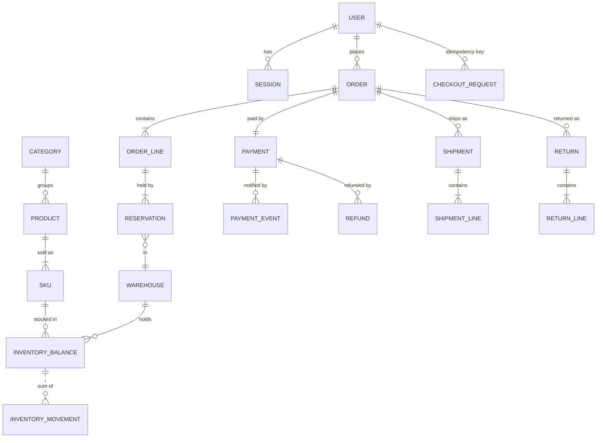
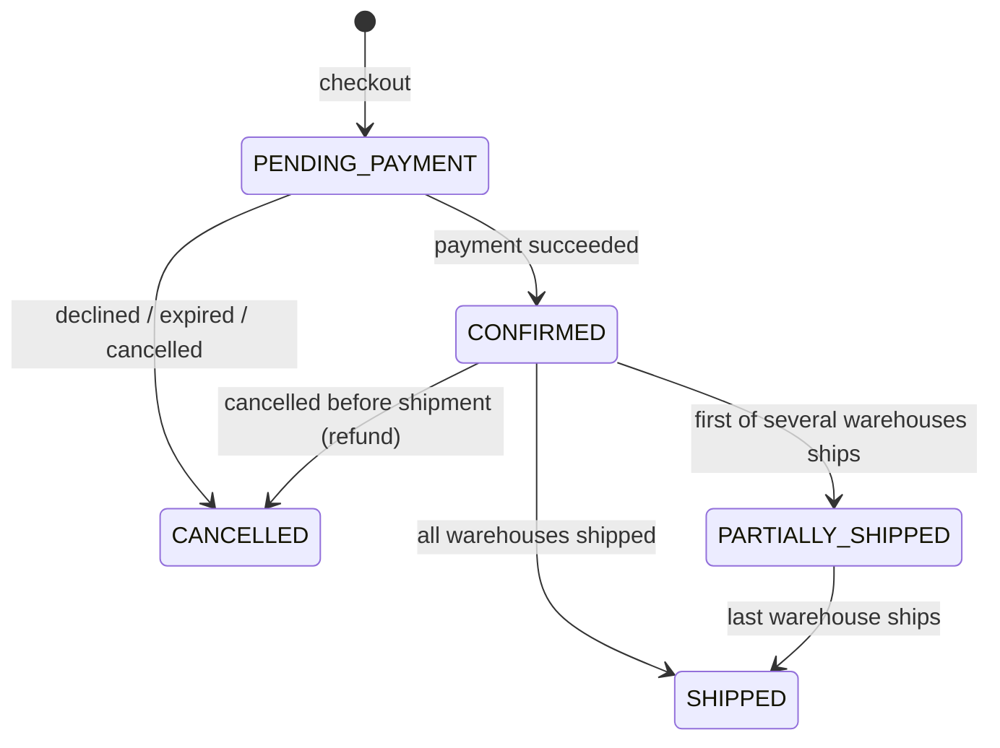

# Domain model

This page describes the business entities and their rules. The SQL lives in
[`infrastructure/postgres/migrations/`](../infrastructure/postgres/migrations/).
The pure rules live in [`packages/domain/src/`](../packages/domain/src/).

## Entities

## Stock quantities

| Quantity | Stored? | Definition |
| --- | --- | --- |
| On-hand | yes (`inventory_balances.on_hand`) | Physical units in one warehouse. |
| Reserved | yes (`inventory_balances.reserved`) | Units held for unshipped orders. |
| Available | no | `on_hand - reserved`. What checkout can promise. |

A reservation changes **reserved** only. A shipment reduces **both** on-hand
and reserved, because the units leave and the promise is fulfilled at the same
time. A return restock increases on-hand only.

Example for one SKU in WH-EAST:

| Event | Movement | on_hand | reserved | available |
| --- | --- | --- | --- | --- |
| Receipt of 10 | RECEIPT +10 / 0 | 10 | 0 | 10 |
| Checkout of 3 | RESERVE 0 / +3 | 10 | 3 | 7 |
| Payment declined | RELEASE 0 / −3 | 10 | 0 | 10 |
| Checkout of 4, paid | RESERVE 0 / +4 | 10 | 4 | 6 |
| Shipped | SHIP −4 / −4 | 6 | 0 | 6 |
| Return of 1 received | RETURN_RESTOCK +1 / 0 | 7 | 0 | 7 |
| Damage found | ADJUSTMENT −2 / 0 | 5 | 0 | 5 |

## State machines

Reservations: `ACTIVE → CONFIRMED → SHIPPED`, and `ACTIVE | CONFIRMED → RELEASED`.
Payments: `PENDING → CAPTURED | DECLINED`, `CAPTURED → PARTIALLY_REFUNDED → REFUNDED`.
Returns: `REQUESTED → RECEIVED → REFUNDED`.

The transition tables are data in
[`state-machines.ts`](../packages/domain/src/state-machines.ts) and are unit-tested.

## Rules that live in `@ofl/domain`

| Rule | File |
| --- | --- |
| Allocation across warehouses | [`allocation.ts`](../packages/domain/src/allocation.ts) |
| Cancellation and return eligibility | [`eligibility.ts`](../packages/domain/src/eligibility.ts) |
| Reservation expiry | [`reservations.ts`](../packages/domain/src/reservations.ts) |
| Money arithmetic in minor units | [`money.ts`](../packages/domain/src/money.ts) |
| Retry classification and backoff | [`retry.ts`](../packages/domain/src/retry.ts) |
| Input validation | [`validation.ts`](../packages/domain/src/validation.ts) |
