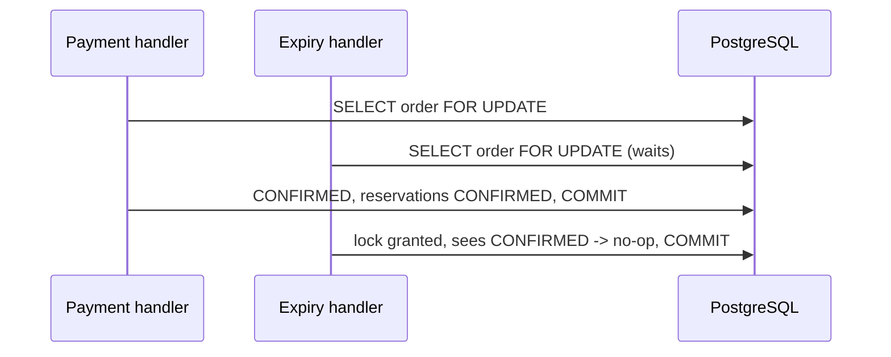
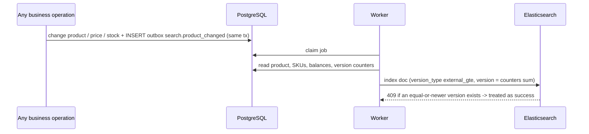

# Workflows

The normative steps are in [requirements.md §6](requirements.md#6-workflows).
This page shows the same flows as sequence diagrams.

## Checkout and payment

```mermaid
sequenceDiagram
  participant C as Customer UI
  participant A as API (GraphQL)
  participant P as PostgreSQL
  participant W as Worker
  participant G as Simulated gateway
  C->>A: checkout(idempotencyKey, lines, token)
  A->>P: BEGIN
  A->>P: INSERT checkout_requests ON CONFLICT DO NOTHING
  A->>P: SELECT balances ... ORDER BY sku_id, warehouse_id FOR UPDATE
  A->>P: INSERT order, lines, reservations, RESERVE movements, payment
  A->>P: INSERT outbox payment.authorize, reservation.expire, search.product_changed
  A->>P: pg_notify('order_events', orderId)
  A->>P: COMMIT
  A-->>C: CheckoutSucceeded (PENDING_PAYMENT)
  C->>A: subscribe orderUpdated(orderId)
  W->>P: claim payment.authorize (SKIP LOCKED, lease)
  W->>G: charge(idempotency key = payment id)
  G-->>W: provider event (same id on retry)
  W->>P: BEGIN; lock order; INSERT payment_events ON CONFLICT DO NOTHING
  W->>P: payment CAPTURED, order CONFIRMED, reservations CONFIRMED, pg_notify; COMMIT
  W->>P: mark job DONE
  P-->>A: NOTIFY order_events
  A-->>C: orderUpdated (CONFIRMED)
```

If the worker stops between the gateway call and "mark job DONE", the lease
expires, another worker claims the job, the gateway returns the same provider
event, and `payment_events` rejects the duplicate. The final state is the same.

## Reservation expiry race



If the expiry handler gets the lock first, it cancels the order and releases
stock. The payment handler then sees CANCELLED, records the capture, and
creates a LATE_PAYMENT refund.

## Fulfillment from two warehouses

1. Allocation splits a line across WH-EAST and WH-WEST when neither can serve it alone.
2. The operator ships WH-EAST: order `PARTIALLY_SHIPPED`.
3. The operator ships WH-WEST: order `SHIPPED`.
4. Shipping WH-EAST again returns `NothingToShip`; the unique key
   `(order_id, warehouse_id)` on `shipments` is the database guard.

## Return and refund

1. Customer requests a return for part of a shipped line (`REQUESTED`).
2. Operator receives it: RETURN_RESTOCK movement into the warehouse that shipped
   the units, refund row PENDING, `refund.process` job (`RECEIVED`).
3. Worker refunds through the gateway (idempotent key = refund id), updates the
   payment refunded amount, marks the return `REFUNDED`.

## Search synchronization


